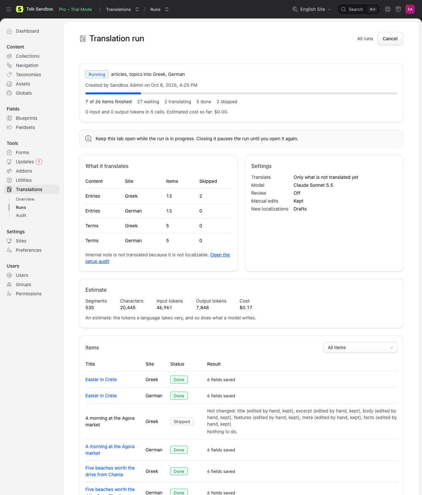
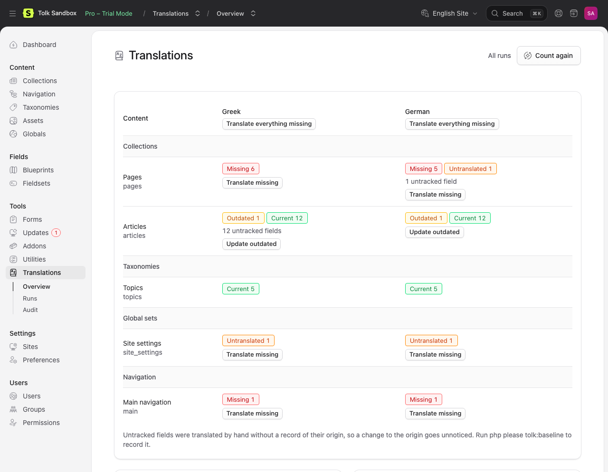

# Bulk translations and runs

A **run** translates many items in one go and saves the translations server-side. Each item of a run is one target: an entry, a term, a global set or a navigation in one site.

Runs are started from:

- the **Translate…** action in entry and term listings and in a structured collection's tree view;
- the [Overview](#the-overview), which also translates global sets and navigation;
- an origin entry's **Translate into…** and **Update translations** ([The editor](editor.md#in-the-origin)), a run of that one entry;
- saving a published origin entry, when automatic updates are on ([Automatic updates](#automatic-updates));
- the command line, `tolk:translate` and `tolk:site` ([The command line](cli.md)).

In the CP they need the `run bulk translations` permission, except the origin entry's buttons, which need `translate content`. The commands need no permission.

A run saves the content, not a form that is open on it. A form opened before the run (an entry's, a term's or a global set's) puts back what it was opened with when it is saved after the run ([Forms opened before a run](editor.md#forms-opened-before-a-run)).

## The listing action

Select entries or terms in a listing (or open a page's dropdown in the tree view) and choose **Translate…**:

- **Translate into**: the sites of the selected items' collections or taxonomies that you may access, except a site that every selected item is translated from, since there is nothing to translate into it. All are checked except the site they are translated from: the default site for entries, the taxonomy's first site for terms.
- **What to translate**:
  - *Only what is not translated yet* (`missing`): missing localizations and untranslated fields.
  - *Also update outdated translations* (`update`): the above, plus fields whose source changed since they were translated.
  - *Retranslate everything* (`all`): every field again.
  - *Review existing translations* (`review`): no translation; a second model reviews the machine translations that are up to date and its corrections are saved (see [Review](review.md#reviewing-existing-translations)).
- **Overwrite manual edits**: also replace fields edited by hand (in review mode: review them too; they stay edited by hand).
- **Review after translating**: review every translation with a second model before it is saved. The default comes from the settings.
- **New localizations** (entries only): **Drafts**, or **Same as origin** to publish a new localization when its origin is published, the user who created the run may publish it, and every field was translated completely. The default comes from the settings.

Selecting a localization translates its whole family: the origin into every chosen site. The action needs `run bulk translations` and the right to edit the selected items; a term counts when you may edit it in any site of its taxonomy, so a translator without access to the taxonomy's first site still translates its terms into the sites they may access. The action is not offered for single-site collections, for collections and taxonomies excluded in the settings, or in the entry form (the banner covers that). It creates the run without starting it and opens its page.

## The run page

**Tools › Translations › Runs** lists the latest runs you may see. A run's page shows:



- **Before it starts**: the items per content type and site, what was left out and why (an excluded collection, a site the collection does not have, items you may not edit), the models and options, and an estimate that fills in while Tolk scans the items: segments, characters, tokens and cost. The estimate counts only what will be sent, so text that is up to date or reused costs nothing; it is always an estimate, because languages and models differ. An item that waits for others is counted as it is now and planned again when its turn comes: a German page translated from the Greek one the run updates (with revisions, only once that update is published, see [Revisions](#revisions)), or a navigation that links pages the run creates. **Start** is available at once; the estimate does not have to finish. Start ends the estimate: the page keeps the numbers so far and says how many of the items they cover.
- **While it runs**: a progress bar, the tokens used and the cost so far, and the items with their status, the fields saved, the fields left out and why, the fields that could not be translated and why (none of their parts, or any with [Strict fields](statuses.md#fields-left-partly-untranslated) on), the reviewer's corrections (**View changes**, see [Review](review.md#reviewing-existing-translations)), and errors. Filter the items by status. **Cancel** stops the run after the requests in flight; everything saved so far stays saved.
- **When it ends**: the result. **Retry failed** sends the failed items back, together with the items skipped because an item they depend on failed. **Resume** continues a cancelled or stopped run with its unfinished items.

When text fields were left out because they are not localizable, the page says so and links to the [Audit page](#the-audit-page), so "nothing was translated" has an explanation.

Users who may edit Tolk's settings can clear the list with **Reset** on the runs list: after a confirmation it deletes every completed, cancelled and aborted run they may see, with its results, so it can no longer be resumed or retried. Pending and running runs stay, and so do the translations the deleted runs saved. Without it, `tolk:prune` deletes runs after `runs.retention_days` days without activity.

A run's status is one of *Not started*, *Running*, *Completed*, *Completed with errors*, *Cancelled* or *Aborted*. A run is aborted when a provider rejects a request of the translator or the reviewer for good (a wrong API key, an unknown or retired model, a spending limit, a used-up daily quota), or when three items in a row failed because the provider stayed unavailable. A run keeps the models it started with: after fixing a key or a spending limit, or once the quota resets, **Resume** continues it; after an unknown or retired model, start a new run. An item fails after ten waits in a row for a provider that keeps asking to wait; such waits pause the item, not the run.

An item whose save throws an error (a listener of your app that fails, for example) is saved again after 5 and then 10 seconds, and fails at the third attempt with that error. Text an attempt saved before it threw counts as the run's own, not as an edit, so the next attempt saves it again. A localization an attempt created is finished as a new one, with the status of **New localizations** and, in a collection of the **Translated slugs** setting, the slug of its translated title, unless someone changed them in the meantime: a slug someone gave it is kept, and a localization someone published stays published.

### The order of the items

Items are translated in parallel, but some wait for others:

- A new page of a structured collection waits for its parent page's localization, so it is placed under it in the target site's tree. Pages are saved in the order their translations finish, and each is placed at its origin's position among its siblings, so the target's tree ends up in the origin's order.
- On a collection whose tree has a root (a home page), the root page goes first in a site whose tree is still empty: the first page placed in an empty tree becomes that site's home page. A page whose root page has no localization in that site, and is not in the run, is skipped with "Translate Home into Greek first."
- A site translated from another localization (`de_CH` from `de`) waits for that localization.
- Navigation is translated after the run's entries, so its branches can link the new localizations.

When an item fails, the items that wait for it are skipped ("An item it depends on failed."); **Retry failed** sends both back.

## Drivers

A run started in the CP is driven in one of two ways, decided by `runs.execution` (default `auto`):

- **Queue** when the app's queue connection (or `runs.queue.connection`) has a worker, so not `sync`, `deferred`, `background` or `null`. Lane jobs (`concurrency.queue`, default 4) translate and save until the run ends. You can close the page.
- **Browser** otherwise. The run page does the work: it keeps `concurrency.browser` lanes (default 2) sending requests, and one more loop saving what is translated.

Runs from the command line are driven by the command, with worker processes (see [The command line](cli.md#how-the-command-runs)). Their page shows their progress like any other.

Automatic updates have no page to drive them, so they run on the queue, in the process that saved the entry, or in the queue worker of the job that saved it ([Automatic updates](#automatic-updates)).

### "Keep this page open"

With the browser driver, the run moves only while its page is open: "Keep this page open while the run is in progress. Leaving it pauses the run until you open it again." While the page drives the run, it asks before you close or reload the tab and, as for unsaved changes, before a link or **Back** takes you elsewhere in the CP (Statamic's **Confirm Dirty Navigation** preference turns that second question off). A run you started from the entry editor with **Translate into…** or **Update translations** goes on when you leave its page inside the CP, if the editor showed it in this tab since the last reload: the editor drives it again until you close the tab, so its page says "Keep this tab open while the run is in progress" and asks only before the tab closes. Nothing is lost when the page closes: the next time anyone who may see the run opens its page, the run continues. A run page that is already open, in another tab or another user's browser, does the same once it reads a run that was started, resumed or taken over elsewhere: a page that follows a queue run reads it every two seconds, any other page when its estimate finishes or when you filter the items or turn to another page of them. An item the closed page was working on is picked up again after about 80 seconds. A scheduled `tolk:prune` stops a run that made no progress for five minutes, a browser-driven one whose page stayed closed included; its page then offers **Resume** ([Stalled runs](#stalled-runs)).

Every request does at most one provider call and returns, so no request runs into a web server or proxy timeout. Each lane holds a PHP worker for as long as the page is open; keep `concurrency.browser` low on hosting with few PHP workers. `tolk:doctor` says how many workers a browser-driven run keeps busy.

### Queue workers

On a queue, each lane is a job that starts requests for up to 25 seconds, waits for the last one, saves what is ready and dispatches itself again. Laravel hands out a job a second time when it runs longer than the connection's `retry_after`, so Tolk ends each job before that:

- Keep `retry_after` above `http.timeout.web` + 40 seconds, which is 85 with the default timeout of 45. Laravel's default of 90 is enough.
- On SQS, which has no `retry_after` of its own, add `retry_after` to the connection with the same value as the queue's visibility timeout. Without it Tolk assumes 90 seconds.

```php
// config/queue.php
'connections' => [
    'redis' => [
        // …
        'retry_after' => (int) env('REDIS_QUEUE_RETRY_AFTER', 90),
    ],
    'sqs' => [
        // …
        'retry_after' => 120, // the queue's visibility timeout, in seconds
    ],
],
```

With a `retry_after` of 120, each lane job starts requests for up to 30 seconds and Laravel stops a job that runs longer than 110.

A lane that is killed is started again, up to five times in a row. If no worker works on a queue run for a while, its page shows "This run is not moving" with **Resume** and **Run in this browser instead**, which hands the run to the page (the browser driver) for a site whose queue has no worker after all.

### Automatic updates

With `auto_update` on ([Configuration](configuration.md#automation)), saving a published origin entry starts a run of that entry, as its **Update translations** button does ([The editor](editor.md#automatic-updates)). A run with nothing to update is not kept; one whose origin changed only without text (a toggle in a Replicator set) is, and rebuilds the localizations without calling a model. No page drives it:

- **With a queue worker** (`runs.execution` is `auto` or `queue`, and the connection has a worker), a job waits 10 seconds on the queue, so quick saves of the entry make one update, then starts the run with queue lanes, as above.
- **Without one**, or with `runs.execution` set to `browser`, the PHP process that saved the entry runs it after it has sent its response, so the editor does not wait, on a web server that can send a response before PHP has finished: PHP-FPM (behind Nginx or Apache), LiteSpeed and FrankenPHP. Apache's mod_php, php-cgi (FastCGI without FPM, as on IIS) and `php artisan serve` cannot: PHP only flushes the response, and the browser waits until the run has ended, so Save keeps spinning, a proxy that gives up first (Cloudflare after 100 seconds) reports the save as failed although it was stored, and `php artisan serve`, with its single worker by default, answers no other request meanwhile. Run a queue worker there; the Audit page warns about it (`tolk:doctor`, on the command line, cannot tell). That process stays busy until the run ends, without PHP's time limit, sleeping through the waits a provider asks for. No one waits for its requests, so they have the command line's timeout and size (`http.timeout.background`, `batch.max_chars.background`). A web server that stops a request after a fixed time (PHP-FPM's `request_terminate_timeout`) stops the run with it; the run then stalls, and **Resume** on its page finishes it in the browser. Run a queue worker on a site whose entries are long or have many sites.
- **A save inside a queue job** (an import or another job of the site on a connection with a worker), when Tolk's runs have no worker of their own: a worker's process ends only when the worker stops, so there is no response to wait for. The update waits 10 seconds as a job of its own on that job's connection and queue, and the worker that takes it drives the run as the saving process above would, with the command line's timeout and size (`http.timeout.background`, `batch.max_chars.background`) and without the worker's time limit (`--timeout`), so that worker stays busy until the run ends. While an earlier run of the entry is still moving, the job goes back on the queue for 15 seconds, so the worker goes on with other jobs meanwhile.

A save while an earlier run of the entry is still moving waits for that run (up to 15 minutes), so the same fields are not translated twice. A run started from the entry's banner counts too. Without a queue worker, one PHP process per entry and user does the waiting: a further save meanwhile hands its update to that process and frees its own at once, and the run that follows covers every save made while it waited. If the web server stops the waiting process, the saves made in the following minute update nothing; save the entry again, or press **Update translations**.

On the runs list an automatic run says **Automatic update**, and its page "Started automatically on …, when … saved the entry." It translates as the user who saved the entry: the sites they may not access or edit are left out, so they can follow and cancel it from the banner. A save a run makes counts as that run's creator's, so when the update saves a published localization that other localizations are translated from, their own update runs as the same user. Such an update waits until the run that saved the localization is done with the sites it is still to translate from it, whatever that run's mode, and then translates only what is still outdated: a bulk run into Greek and German, where German is translated from Greek, translates German once, and when the run stops before German, the update translates it. On a web server that cannot send a response before PHP has finished, the browser saves the run's next items only once that response has arrived, so there the update does not wait: it leaves those sites to the run and updates the others. A save without a signed-in user, from code or a command, may update every site.

### Stalled runs

A run whose driver has gone (a closed command, a dead worker, the process of an automatic update) is shown as not moving on its page. `tolk:prune` stops runs that made no progress for `runs.claim_ttl` seconds (5 minutes by default): it marks them aborted and commits what they saved, so their page offers **Resume**, which translates and saves the rest. See [The command line](cli.md#tolkprune).

## Why one writer

Translating runs in parallel; saving does not. Statamic's Stache keeps the index of all content in the memory of each PHP process and writes it back whole on every save. Two processes saving entries at the same moment therefore lose each other's entries from the index: the files are on disk, but Statamic no longer finds them, and the next run would create them twice.

So every server-side save of Tolk goes through one global lock (`write.lock_seconds`, `write.wait_seconds`): it takes the lock, refreshes the process's view of the content, saves one item and releases the lock. Requests to the model, which take most of the time, run in parallel in as many lanes or workers as configured; only the short saves wait for each other. This holds for every driver and for the CP and the command line at the same time.

## Revisions

On a collection with revisions enabled, runs (and the editor's Translate into…, and the command line) save as Statamic's own forms do:

- A new localization is created as a draft with a revision. With **Same as origin** and a published origin (and the conditions above), it is then published through a publish revision, never saved as published directly.
- Translations of a **published** localization go into its working copy and stay unpublished: an editor reviews and publishes them as usual. The live entry is not touched, even after an editor restored a revision saved while the localization was unpublished (its working copy then says unpublished).
- From the command line, `--publish-changes` publishes those changes, but only when the localization had no unpublished changes before the run (publishing would also publish someone else's work in progress). Otherwise the item gets a warning and the changes stay in the working copy.
- An unpublished localization is saved directly, unless it has unpublished changes: then the translations go into its working copy, which is what its edit page shows.

The working copy and the publish revision carry the message "Translated from {site} with Tolk", for example "Translated from English with Tolk"; the revision that creates a localization has none, as with Statamic's own Localize.

What is translated, and what counts as up to date:

- Runs translate the origin **as it is published**. Changes waiting in its working copy are not translated, and do not make its translations outdated, until someone publishes them.
- A translation waiting in a localization's working copy counts as **up to date**, as the localization's form shows it: the Overview and `tolk:status` count it as current, and an update skips it ("Nothing to do."), although visitors see it only once it is published.
- A site translated from a localization (`de_CH` from `de`) is translated from that localization as published. While the update of `de` waits in its working copy, `de_CH` reads up to date and the run skips it ("Nothing to do."). Once `de` is published, `de_CH` reads outdated, and **Update** translates it, or an automatic update when they are on ([Automatic updates](#automatic-updates)).

## Git

With Statamic's git integration, a run makes one commit ("Content translated") when it ends or is interrupted, with the content and the translation state it saved, instead of one per item.

## The Overview

**Tools › Translations** opens the Overview (`cp/tolk/overview`):



- A row for every collection and taxonomy with more than one site (except those excluded in the settings), every global set with more than one site and every navigation, and a column per target site you may access.
- Each cell counts its items by status (*Missing*, *Untranslated*, *Outdated*, *Needs attention*, *Current*), the fields translated by hand without a record of their origin (untracked; `tolk:baseline` records them), and the items whose state file cannot be read (*with unreadable state*; see [Troubleshooting](troubleshooting.md#a-state-file-cannot-be-read)). On a collection with revisions, a translation that waits in a working copy to be published counts as current ([Revisions](#revisions)). Cells are counted a few at a time when the page opens, and the counts are kept for ten minutes or until the content changes; **Count again** counts afresh and drops the kept counts as it starts, so a count that stops midway never brings them back. A cell whose count failed offers **Try again**, which counts it the same way: afresh after **Count again**.
- **Translate missing** in a cell creates a run of its missing and untranslated items, **Update outdated** one of its outdated items too. **Translate everything missing** at the top of a site's column does it for every row. Each opens the new run's page, where you check the estimate and press Start.
- Global sets and navigation are translated from here (and from the command line); their forms have no banner.
- Below the matrix: the usage this month per model (calls, tokens and the estimated cost), the providers and their keys, and the latest runs.

## The Audit page

**Tools › Translations › Audit** shows the checks of `tolk:doctor`: sites, providers and models, the queue, the cache, the state, and the content checks; only `tolk:doctor` checks the PHP of the command line. Its most useful part lists the text fields that are not localizable, blueprint by blueprint: Tolk does not translate them, because they are shared by every site. Users who may edit Tolk's settings and have **Configure Fields** can tick fields and press **Make localizable**, after a confirmation that names the blueprint file. Fields imported from a fieldset are shown read-only, with a link to the fieldset to change. Unlike `tolk:doctor`, the page does not read every state file to list those that cannot be read, which takes a while on a large site.

## Usage and cost

- Before a run starts, its page and `tolk:translate` show an estimate. Use it to compare models: the fast models cost a fraction of the quality ones.
- During and after a run, its page shows the tokens and the cost of the calls it made.
- The Overview shows the usage of the month per model (the files are in `storage/statamic/tolk/usage/`, one per month), and under each model where it came from:
  - **Editor**: the entry and term editor, and **Generate** and **Test connection** in the settings.
  - **Runs**: the runs started in the CP (the **Translate…** action, the Overview, **Translate into…** and **Update translations**) or with `--queue`.
  - **Command line**: `tolk:translate` and `tolk:site` without `--queue`, `tolk:lang`, `tolk:forms` and `tolk:profile`. A command-line run resumed on its run page counts under Runs from then on.
  - **Automatic updates**: the runs started by saving an origin entry ([Automatic updates](#automatic-updates)).
- Users who may edit Tolk's settings can **Reset** the month's usage on the Overview, after a confirmation: the month's file is deleted and counting starts again from zero. A run's page keeps showing the run's own usage.
- Costs are computed from the prices in the model catalog (`models.*.price`). The monthly usage keeps the price of the day of each call; a run's page computes its cost from its tokens at the current prices. A model without a price makes the cost "unknown".
- Tolk sets no budget caps. Set spending limits with the provider; when one is reached, the provider rejects the requests and the run is aborted with that message.
