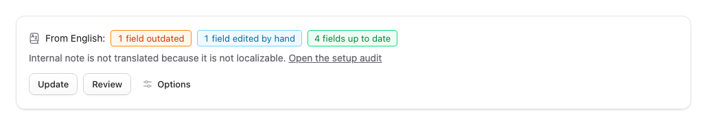
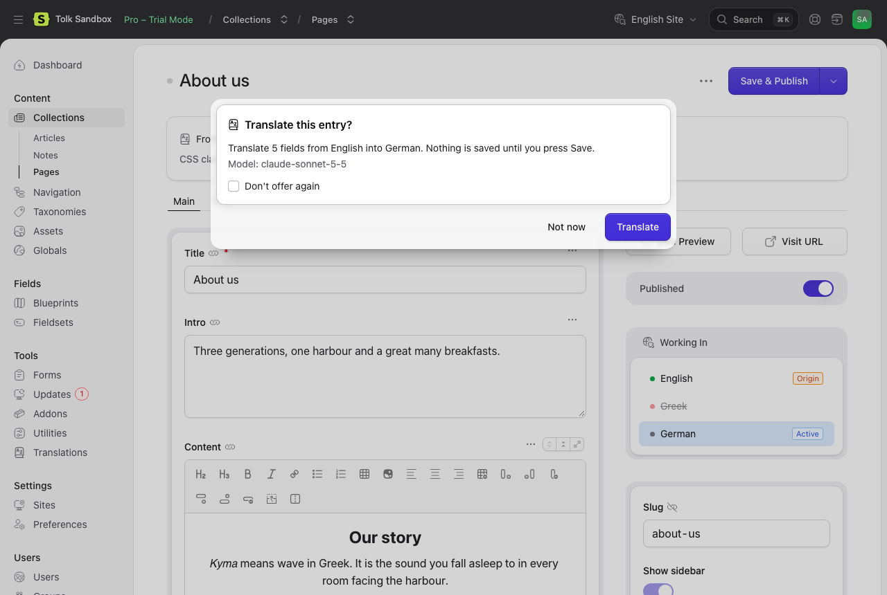

# The editor

Tolk works inside Statamic's entry and term forms. In a localization it fills translations into the open form, where you check them and save as usual: nothing is stored until you press Save. In the origin it translates the saved entry into other sites and saves those translations directly.

## The banner

The banner sits above the form's tabs. It appears when:

- the collection (or taxonomy) has more than one site and Statamic's multi-site is on;
- the collection (or taxonomy) is not excluded in the settings ([Configuration](configuration.md#content));
- you have the `translate content` permission and may edit the entry;
- the form is not read-only.

It does not appear on the create page of a new entry, in stacked editors (an entry opened from a relationship field), in global sets or in the navigation editor. Global sets and navigation are translated from the [Overview](bulk-and-runs.md#the-overview) and the [command line](cli.md).

### In a localization

The banner shows how many fields are untranslated, outdated, edited by hand, need attention or are up to date ([Statuses](statuses.md) explains each), and the fields that are not translated because they are not localizable, with a link to the Audit page for users who may open it. Hover or focus a count to see what it means.

- **Translate** fills the untranslated fields.
- **Update** fills the untranslated fields and translates the outdated ones again. Only the paragraphs whose source changed are sent to the model; the others keep their earlier translation.
- **Review** asks a second model to check the translations in the form (see [Review](review.md)).
- **Options** opens the translation options (below).

While a translation runs, the fields fill in as their parts come back, a progress bar shows how far it is, and **Cancel** stops it. Fields already on their way are still filled in. Save is refused while a translation runs ("A translation is in progress. Wait for it to finish, or cancel it."), because the form would be saved half translated.

When it has finished, the banner says what happened: how many fields were translated and with which model, and which fields were skipped or failed. **Undo** puts back the fields as they were before the translation, as long as you have not saved; text you typed into a field after it was filled is kept. **Retry** (or **Start again**, when the translation cannot continue where it stopped) repeats a translation that failed.

The filled fields are not saved yet. Read them, change what you like, then press Save. After the save, Tolk records what it translated:

- A field you did not change after it was filled counts as machine-translated, so a later change to the origin marks it outdated and Update replaces it.
- A field whose text you changed before saving counts as edited by hand: Translate and Update leave it alone from then on (see [Statuses](statuses.md#manual-fields)).

A field you typed into before pressing Translate is skipped, and the banner names it ("Intro was skipped because you edited it."), so your text is never overwritten. A field hidden by a condition when you saved is not saved by Statamic; the banner lists it so you can show it and save again.

### Slugs

Slugs are never translated. A new localization keeps its origin's slug: Statamic's form would normally derive the slug from the translated title, so Tolk puts the origin's slug back when it fills a localization you just created. A slug that already exists is never changed. Change a slug by hand if you want one in the target language.

### The offer

When you create a localization in the form (by picking a site that has none in the **Sites** panel), Tolk offers to translate it:

It appears when:

- the **Offer to translate new localizations** setting (`offer_on_create`) is on;
- you have not turned the offer off for yourself;
- a model is available (a provider has an API key);
- the new localization has untranslated fields.

**Translate** fills the fields, as the banner's Translate does; **Not now** (or Esc) leaves the form as Statamic created it. When the collection has more than two sites and lets you choose where a localization starts from, Statamic first asks which site to copy from; the offer comes after that.

**Don't offer again** turns the offer off for your user only. Turn it back on with **Offer to translate new localizations** in the options menu. The offer never changes the slug (see above).

Terms have no offer, because a term exists in every site of its taxonomy and the form never creates one. Use the banner's Translate there.

## The options menu

**Options** in the banner opens the translation options:

- **Model**: the model to translate with. The menu remembers your choice for your user and preselects it the next time; the banner's Translate and Update and the offer always use the model of the settings. Choosing the default model forgets your choice. Users who may edit Tolk's settings may also type a model outside the list, as `provider:model`.
- **Retranslate everything**: translates every field again, the up-to-date ones too. Without it, the menu's Translate fills untranslated fields and updates outdated ones, as Update does.
- **Overwrite manual edits**: also replaces the fields edited by hand. They count as machine-translated afterwards.
- **Review after translating** and **Reviewer**: review this translation with a second model, whatever the setting says, and with which model (see [Review](review.md)).
- **Translate** and **Review** run the translation or the review with these choices.

Every time the menu opens, **Retranslate everything** and **Overwrite manual edits** start unchecked and **Review after translating** starts as the setting says.

Under **Translation status** are two actions, each shown only while it has something to do:

- **Mark manual fields as up to date** records that the fields edited by hand match the current source. They stay edited by hand, and a later change to the source shows them as needing attention. Use it after you checked hand-written fields against their source, and on content translated by hand before Tolk was installed.
- **Protect this entry from updates** turns the entry's translated fields into fields edited by hand, so Translate and Update leave them alone from then on. It also marks the fields that were already edited by hand as up to date. It is shown while the entry has a machine-translated field, up to date or outdated.

**Offer to translate new localizations** turns the offer on or off for your user. It shows only while the setting is on.

## Translating one field

Every top-level field Tolk can translate has **Translate from origin** in its field actions (the menu next to its label), in a localization:

1. Open the field's actions and choose **Translate from origin**.
2. Confirm: "The current content of this field will be replaced."

The field is translated again from the origin, whatever its status, edited by hand included, and filled into the form unsaved. The rest of the form is left alone.

The action is not offered on nested fields (inside a Replicator, Grid or Bard set), on fields that are not localizable, in the origin, or while another entry is open in a stack.

## In the origin

On the origin entry, the banner lists each localization with its status, for the sites you may access. A missing localization reads "Not created yet". The names link to the localizations.

- **Translate into…** opens a dialog with the sites that have no localization or have untranslated fields, all checked. **New localizations** chooses whether new ones are saved as **Drafts** or the **Same as origin** (published when the origin is; it needs the publish permission). **Review after translating** reviews each translation before it is saved.
- **Update translations** updates every localization with outdated fields.

Unlike the rest of the editor, these save the translations directly, in each localization, as a run of this one entry. They translate the **saved** entry, so both buttons wait while the form has unsaved text ("Save first: the translations are made from the saved entry."). The open form is not changed.

While the run goes, the banner shows its progress and **Cancel**. When Tolk's runs are driven by the browser (a site without a queue worker, see [Bulk translations and runs](bulk-and-runs.md#drivers)), the open page does the work: keep it open until the translations are saved. If you leave, the run continues the next time you open the entry, unless a scheduled `tolk:prune` stopped it after five minutes without progress; then start it again. With a queue worker, the run continues on its own.

When it has finished, the banner shows a line per site with a link to the localization and its result. New localizations appear in Statamic's **Sites** panel after a reload, which **Reload** does.

You need only `translate content` for this: you follow, cancel and resume the run you started from the entry, without seeing the Runs pages.

## Collections with revisions

In the editor, Tolk only fills the form, and Statamic saves it as it always does: on a collection with revisions, your Save goes to the working copy, and publishing stays a separate step. What happens when Tolk saves server-side (Translate into…, bulk runs, the command line) is in [Bulk translations and runs](bulk-and-runs.md#revisions).
