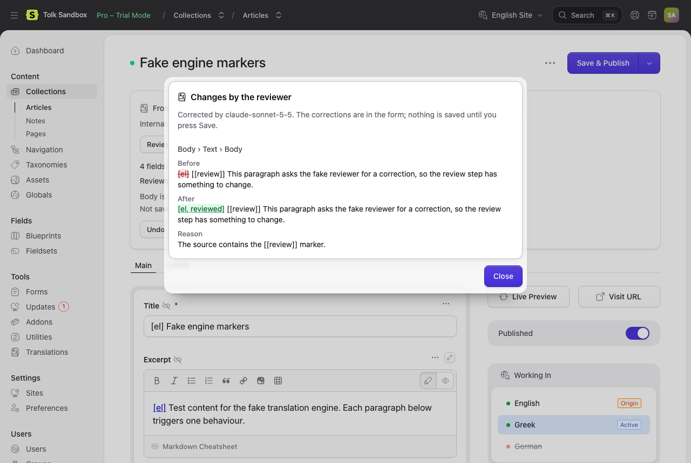

# Review

Review lets a second model check the first one's work. The reviewer receives each piece of source text with its translation and returns corrections only for the pieces it would change, each with a reason. Tolk applies the corrections automatically and lists them, so you can see what changed and why.

Because only corrections come back, a review costs mostly input tokens: the source and the translation are sent again, and the answer is short. Still, review roughly doubles the time and the cost of a translation. Paragraphs Update reuses from an earlier translation are not reviewed again.

## Turning it on

Review is off by default. On the settings page:

- **Review translations** (`review_enabled`) reviews every translation.
- **Reviewer model** (`reviewer_model`) chooses the reviewer. *Automatic* uses the quality model of another provider with an API key (a translation by Claude is reviewed by GPT or Gemini), or the translator's own model when only one provider has a key.

These override the setting for one translation:

| Where | How |
| --- | --- |
| Editor | **Review after translating** and **Reviewer** in the options menu |
| Origin view | **Review after translating** in the Translate into… dialog |
| Listing action | **Review after translating** toggle |
| Command line | `--review`, `--no-review`, `--reviewer=provider:model` |

The banner's Translate and Update, the offer, **Translate from origin** and the origin view's **Update translations** follow the setting.

The reviewer can be any model of the catalog whose provider has a key, including the translator's own; users who may edit the settings may also name a model outside the catalog.

A correction is checked like a translation: when it breaks the formatting (a lost placeholder, a new link), it is discarded and the translation is kept. When the review request fails (the provider is down, the answer is cut off or refused), the translation is kept as it was: the editor says "Part of the text could not be reviewed and was kept as it was.", and runs and the command line add the warning "review skipped". Such a failure never fails the translation. A reviewer the provider rejects (a wrong key, an unknown model, a spending limit) stops the translation as a rejected translator does: the editor reports the error, and a run is aborted.

There is one automatic round. To review again, use Review (below).

## In the editor

With review on, the banner's Translate and Update review each part as soon as it is translated, before it is filled in. **Cancel** translates nothing more, but the parts already translated are still reviewed and filled in. The summary then says, for example, "Reviewed with GPT-6.1 Sol: 2 corrections."

- **View changes** opens the reviewer's corrections: for each, the field, the text before and after, with removed words struck through and added words underlined, and the reviewer's reason. The corrections are in the form; nothing is saved until you press Save.
- **Undo** puts back the fields as they were before the translation or review, as long as you have not saved.



**Review** in the banner (and in the options menu) reviews the translations that are in the form, without translating anything: the machine translations that are up to date, and the ones just filled in and not yet saved. Fields edited by hand are left out unless **Overwrite manual edits** is checked in the options; a reviewed field edited by hand stays edited by hand. Checking it also offers **Review** in the options on a localization whose fields were all edited by hand, such as one translated before Tolk was installed. Text the localization only inherits from its origin is not reviewed: it is not translated.

**Review again with another model**: open **Options**, choose another **Reviewer** and press **Review**. The menu remembers your reviewer for your user. Users who may edit the settings may also type a model outside the list.

When Tolk records a saved translation, it records the reviewer next to the translator.

## Reviewing existing translations

Translations made earlier, or with review off, can be reviewed later in bulk:

- the listing action's **What to translate** › *Review existing translations*;
- `php please tolk:translate … --mode=review` (or `tolk:lang` and `tolk:forms` with `--mode=review`).

These review the machine translations that are up to date and save only the corrected fields. With **Overwrite manual edits** (`--force`) they review the fields edited by hand too, which stay edited by hand. A field whose structure no longer matches its source (sets added in the localization alone, for example) is skipped. An item without corrections ends as "Reviewed, nothing to correct."

On the run's page, an item the reviewer corrected says how many corrections it has, and **View changes** shows them as the editor does: for each, the field's handle, the text before and after, and the reviewer's reason. This holds for runs with **Review after translating** too.

```bash
php please tolk:translate --collection=articles --site=el --mode=review --reviewer=gemini:gemini-3.8-flash
```

With `-v` the command lists each correction under its target, with the text before and after and the reviewer's reason:

```text
  Planning a wedding by the sea → Greek: done, 1 field, 1 correction
    title: "Σχεδιάζοντας έναν γάμο στη θάλασσα" → "Σχεδιάζοντας έναν γάμο δίπλα στη θάλασσα" (The wedding is by the sea, not in it.)
  Easter in Crete → Greek: reviewed, nothing to correct
```
